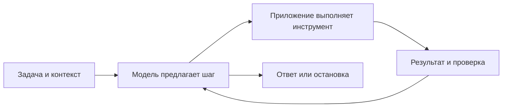

# От LLM к агентному циклу

[К маршруту встречи](../README.md)

## Суть

В современных LLM-агентах модель включают в систему, которая может выбирать действия, выполнять их инструментами, получать результаты и продолжать работу над задачей. Управляющий код приложения связывает модель со средой и определяет доступные действия, условия остановки и проверки.

LLM сделала естественный язык удобным интерфейсом к разным задачам и инструментам. Но термин «агент» шире LLM, а инструментальный вызов сам по себе ещё не означает сложную автономную систему.

## Минимальный цикл

Например, «исправь упавший тест» превращается в последовательность: прочитать тест → найти реализацию → изменить код → запустить проверку → учесть результат → сообщить о выполненном и оставшихся ограничениях.

## Где заканчивается модель

| Компонент | За что отвечает |
| --- | --- |
| Модель | Обрабатывает контекст, генерирует ответ или предложение действия |
| Агентное приложение | Ведёт цикл, формирует вход, маршрутизирует вызовы и результаты |
| Инструмент | Читает файл, ищет информацию, запускает команду или обращается к сервису |
| Среда | Файлы, процессы и внешние системы, с которыми можно взаимодействовать |
| Проверка результата | Даёт основания считать, что задача решена или требует продолжения |

Текст `run_tests()` в обычном ответе не запускает тесты. Нужны распознанный запрос действия, реализация инструмента и фактическое выполнение со стороны приложения.

## Что изменили LLM

Одна модель может интерпретировать разные задачи и описания инструментов, формировать аргументы вызовов и использовать результаты для следующего шага. Это уменьшает потребность вручную описывать каждый переход для каждой формулировки задачи, но не устраняет необходимость проектировать и проверять систему.

Есть заранее заданные workflows, где путь в основном определяет код, и более динамичные агенты, где модель выбирает последовательность шагов. В реальных приложениях подходы смешиваются.

Подробности контекста, памяти, MCP, skills, разрешений и механизмов управления оставляем для следующих встреч. Здесь важно увидеть границу между способностью модели предложить действие и способностью всей системы выполнить и проверить его.

## Источники

- [ReAct, 2022](https://arxiv.org/abs/2210.03629): действия и наблюдения как часть работы языковой модели.
- [Anthropic, Building effective agents, 2024](https://www.anthropic.com/research/building-effective-agents): различие workflows и агентов, роль инструментов и обратной связи. Примеры продуктов в статье отражают время публикации.

Дальше: [задачи в разработке и за её пределами](applications.md).
