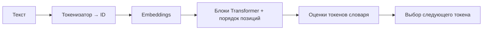

# Что внутри современной LLM

[К маршруту встречи](../README.md)

## Суть

Для нашего разговора берём типичную авторегрессионную LLM с decoder-only Transformer. Текст токенизируется, ID превращаются в векторы, блоки модели преобразуют их с учётом контекста и порядка, а выход даёт оценки возможного следующего токена.

Токенизатор, веса модели и алгоритм выбора продолжения работают вместе, но выполняют разные функции. Название Transformer описывает архитектуру, а не весь чат-продукт.

## Схема одного обращения

Это концептуальная схема; она опускает многие инженерные детали и варианты архитектуры.

## Embeddings и порядок

Для ID токена выбирается обученное числовое представление. Его компоненты не нужно вручную подписывать «тема», «цвет» или «важность»: полезные представления формируются в обучении.

Порядок тоже важен: «сервис вызывает инструмент» и «инструмент вызывает сервис» состоят из похожих слов, но описывают разные отношения. Архитектура учитывает позиции; способы позиционного кодирования различаются.

## Что делает блок Transformer

- **Self-attention** вычисляет, как представление позиции связано с представлениями других доступных позиций. В причинной языковой модели будущие позиции скрыты маской.
- **Feed-forward / MLP** выполняет обученное преобразование представления в каждой позиции.
- **Residual connections и нормализация** помогают передавать и обрабатывать сигналы через много блоков.

Блоки повторяются. Получаются представления, зависящие от контекста, а не только от исходного ID.

В примере «Я положил ключ в карман, а затем достал его» связи между словами помогают обрабатывать местоимение. Это иллюстрация задачи, а не измеренная визуализация attention конкретной модели. Карты attention сами по себе не дают полного объяснения её поведения.

## Выход

Выходное преобразование даёт числовые оценки — logits — для токенов словаря. Из них получают распределение и выбирают продолжение по заданной процедуре. Токен добавляют в последовательность, после чего процесс может продолжиться.

Исходная работа 2017 года описывала encoder–decoder Transformer для перевода. Многие современные генеративные LLM используют другую компоновку на основе decoder; не следует отождествлять их схемы целиком.

## Источники

- [Attention Is All You Need, 2017](https://arxiv.org/abs/1706.03762): attention, блоки, позиционная информация и исходная архитектура.
- [Qwen2.5 Technical Report, 2024](https://arxiv.org/abs/2412.15115): пример семейства современных decoder-only моделей и их обучения.
- [Hugging Face: Transformer architectures](https://huggingface.co/learn/llm-course/en/chapter1/6): различия encoder, decoder и encoder–decoder.

Дальше: [как из этой схемы получается ответ](generation.md).
