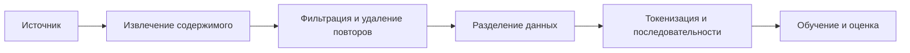

# От сырых данных к обучающему набору

[К маршруту встречи](../README.md)

## Суть

Обучающая система получает подготовленные примеры, а не интернет целиком. Между исходной страницей и обучением стоят извлечение содержимого, фильтрация, удаление повторов, организация выборок и перевод в формат, который принимает модель.

Решения на этом пути влияют на то, какие закономерности модель сможет выучить и насколько честно мы измерим её качество.

## Путь документа



Это упрощённый маршрут: порядок операций и детали различаются между наборами и задачами.

## Что происходит на каждом шаге

1. **Сбор и происхождение.** Выбирают источники, фиксируют доступные метаданные, учитывают условия использования.
2. **Извлечение.** Из HTML получают основной текст, отделяя меню и служебные элементы. Для PDF, кода или диалогов нужны свои правила сохранения структуры.
3. **Очистка и отбор.** Убирают повреждённые документы и нежелательное содержимое. Фильтры также могут ошибаться и исключать полезные примеры.
4. **Удаление дубликатов.** Повторы и почти одинаковые документы меняют баланс набора; их попадание и в обучение, и в оценку искажает результаты.
5. **Выборки.** Разделяют данные для обучения и проверки, учитывая связанные документы и возможные утечки между ними.
6. **Представление.** Текст превращают в токены и подходящие по длине последовательности. Токенизатор обычно уже выбран или отдельно обучен на данных.

## Небольшая демонстрация

Условная исходная страница:

```html
<nav>Главная · Войти</nav>
<article>Тест проверяет поведение функции.</article>
<footer>Тест проверяет поведение функции.</footer>
```

Нужно решить, где основное содержание, является ли повтор полезной цитатой или шумом и не потеряли ли мы контекст. Для документа с кодом слишком агрессивная очистка может удалить значимые отступы.

Это демонстрация решений при подготовке данных, а не утверждение, что всем моделям передают только очищенный текст: HTML и другие структурированные форматы тоже могут быть полезными обучающими примерами.

## Источники

- [FineWeb: подготовка крупного веб-корпуса, 2024](https://arxiv.org/abs/2406.17557).
- [Deduplicating Training Data Makes Language Models Better, 2021](https://arxiv.org/abs/2107.06499).

Дальше: [как развивались методы работы с данными и языком](history.md).
